# NotchOne

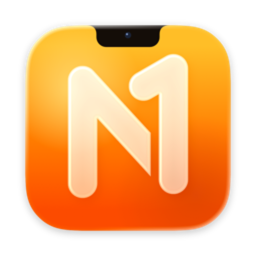

A free notch app for macOS: the notch (or a drawn notch on displays without one) becomes
a small glass panel for what's playing, the weather, files, the clipboard, translation, calls, notifications and
more. Pure Swift and SwiftUI with no third-party packages; no accounts, no analytics, and it
idles at 0% CPU. In English and Turkish.

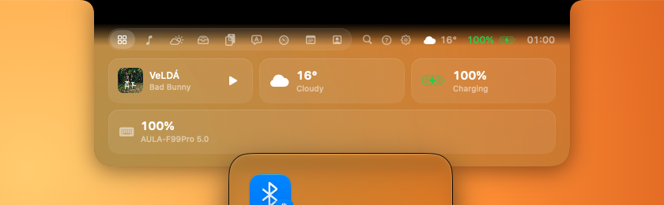


## Install

**[Download NotchOne](https://notchone.one/download)** or visit [notchone.one](https://notchone.one). Unzip it and move NotchOne to Applications. It's signed and
notarized by Apple. A short tour opens in the notch on the first launch; the `?` next to the
tabs shows it again. NotchOne checks for updates once a day (Settings → About) and installs
one only if it's signed by the same developer.

## Screenshots

On a display with a notch it grows out of the notch; on one without, it can be a floating pill
(Settings → Appearance → Shape).

### Notch

| | |
|---|---|
|  | 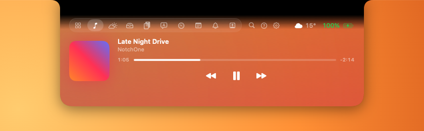 |
| Home | Now Playing |
| 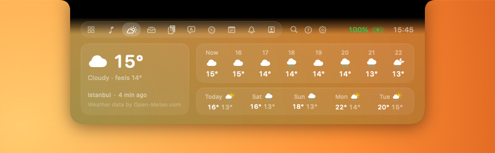 | 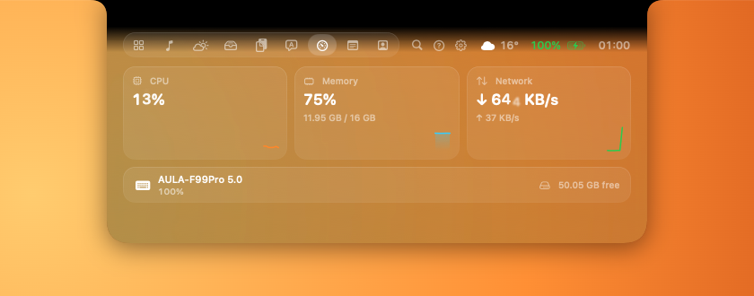 |
| Weather | System and device batteries |
| 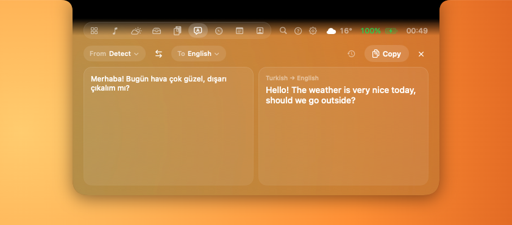 | 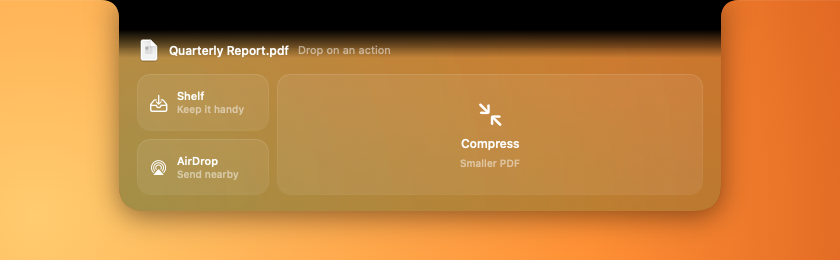 |
| Translate | Drop a file |
| 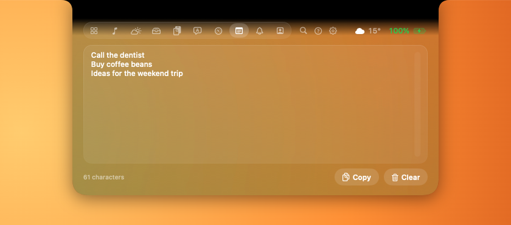 |  |
| Notes | Compact mode |
|  | 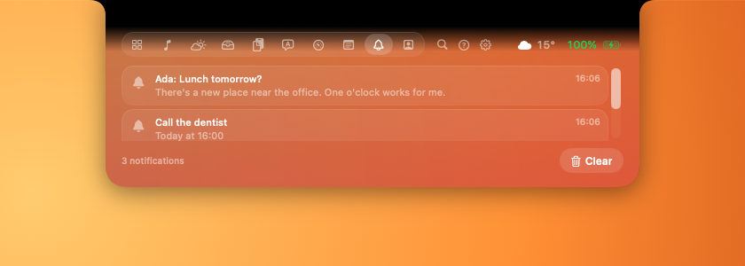 |
| A notification | Notifications tab |
| 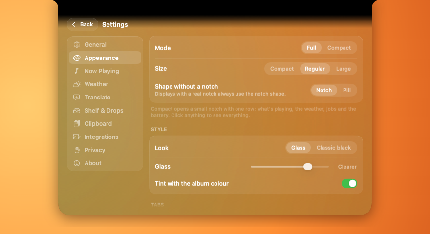 | 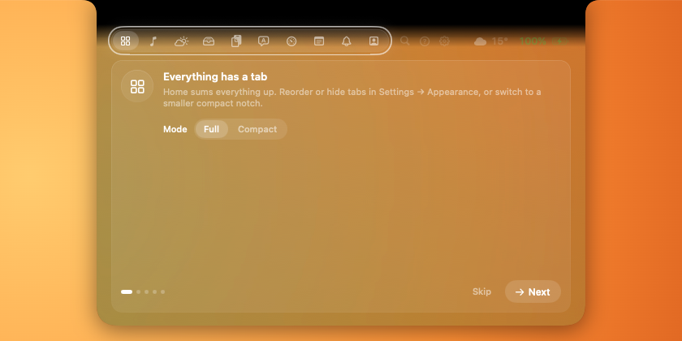 |
| Settings in the notch | The tour |

<details>
<summary><b>Pill</b> (displays without a notch)</summary>

| | |
|---|---|
| 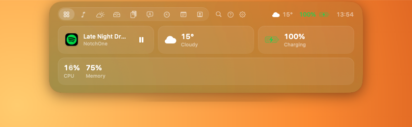 | 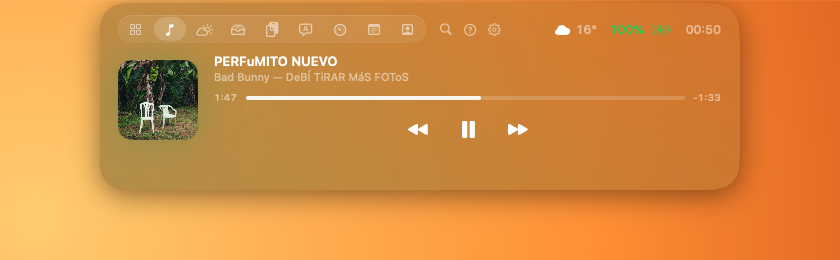 |
| Home | Now Playing |
| 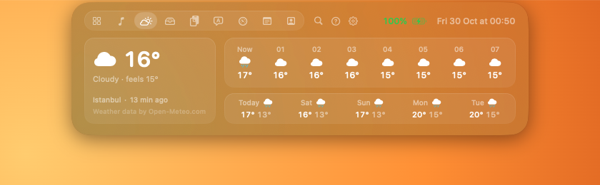 | 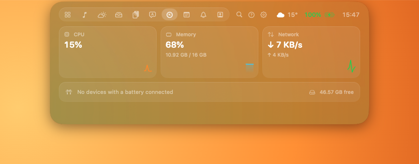 |
| Weather | System and device batteries |
| 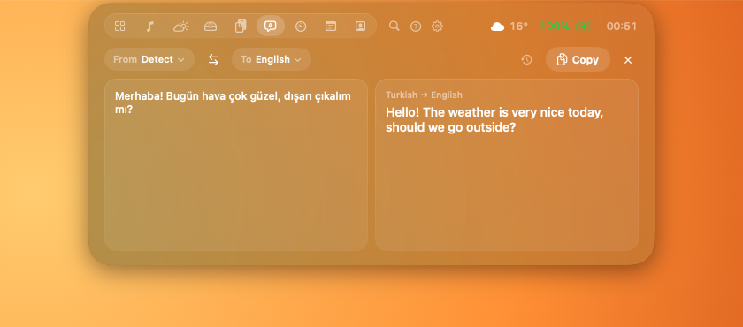 | 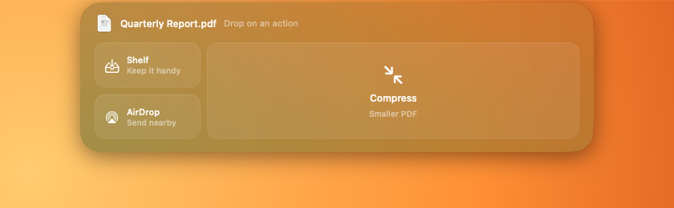 |
| Translate | Drop a file |
| 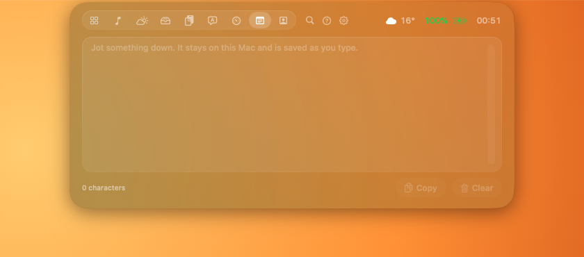 | 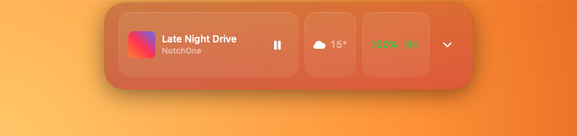 |
| Notes | Compact mode |
|  | 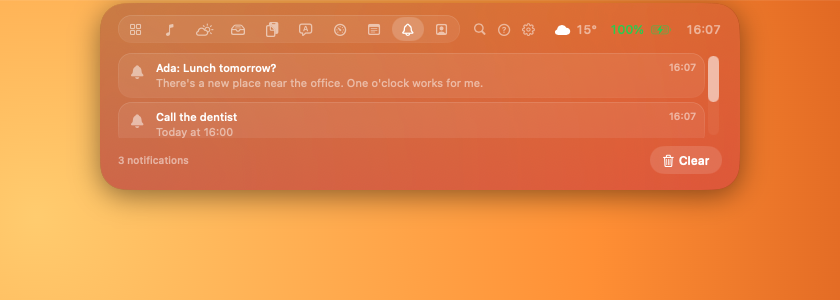 |
| A notification | Notifications tab |
| 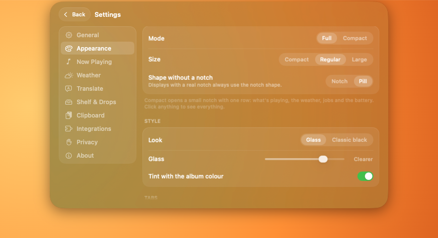 | 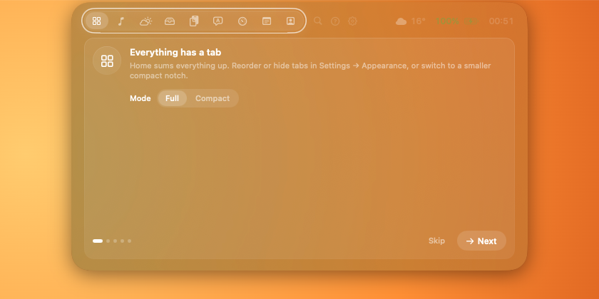 |
| Settings in the notch | The tour |

</details>

## What it does

**The notch.** Hover (70 ms) or click to open. It's black where it meets the hardware notch,
then pours into Liquid Glass tinted with the album colour. Style, glass strength, size,
pill shape (displays without a notch) and tab order are in Settings → Appearance.
Trackpad: swipe sideways on the tab bar to switch tabs, on Now Playing to skip tracks;
swipe down on the closed notch to open it.

**Tabs**
- **Home:** a card for each thing going on: music, weather, battery, notifications, clipboard, shelf. Compact mode (Settings → Appearance) shows one short row instead.
- **Weather:** now, hourly and 5 days, from Open-Meteo. Your area is rounded to about 1 km, or type a city.
- **Search** (⌃⌥K): clipboard history, shelf files and tabs.
- **Translate** (⌃⌥T translates the selection in any app): on-device with Apple's Translation, between any languages macOS supports.
- **Now Playing:** Music, Spotify, and browsers or video apps through the system's Now Playing info.
- **Shelf:** files kept handy. Drag them back out, AirDrop them, or open them.
- **Clipboard:** recent copies (in memory only; private copies and known password managers skipped). Colours, links, JSON and code get their own cards.
- **System:** CPU, memory and network with a minute of history, free disk space, and the battery of AirPods (left, right, case), Magic Keyboard, Mouse and Trackpad. It measures only while it's on screen.
- **Notes:** one quick scratchpad that saves as you type, in Application Support.
- **Mirror** (optional): a camera preview before calls.

**In the closed notch:** volume, brightness and keyboard light popups (instead of the
system ones), battery and charging, Bluetooth devices, new screenshots and
downloads (drag the thumbnail into any app), meeting mode with which app has the camera or
microphone, and a moon while a Focus is on (opt-in).

**Drop files on the notch** and it splits into zones for the file type: Shelf, AirDrop,
Remove background, Compress, Convert (images), Compress, Merge (PDFs) or Copy path. Results
are saved next to the original and land on the shelf.

**Shortcuts**

| Keys | Does |
|---|---|
| ⌃⌥T | Translate the selected text, on-device |
| ⌃⌥K | Search clipboard, shelf and tabs |

**Lock screen (experimental):** a Now Playing and battery card under the notch while the Mac
is locked. Off by default (Settings → General); uses a private macOS feature.


## Command line

The `notch` command (Settings → Integrations → Install, linked into `~/.local/bin`):

```bash
notch run make test            # spinner while it runs, then ✓/✗ and the time
notch run --label "Tests" make test  # the label to show; otherwise only the program name
notch progress 0.4 "Uploading" # from a script; "-" for unknown progress
notch done                     # or: notch fail
notch say "Deploy finished"
```

`notchone://progress?id=…&label=…&fraction=…` and `notchone://say?text=…` do the same
from Shortcuts or a browser.

## Privacy

The app has no accounts, analytics or third-party code. What leaves your Mac: your area for the
weather (rounded to about 1 km, sent to [Open-Meteo](https://open-meteo.com/), at most every
30 minutes and only while you use the notch), Spotify's cover image while it plays, and a
once-a-day update check to NotchOne's website (can be turned off). The full list is in Settings → Privacy
and in [website/privacy.html](website/privacy.html). Permissions are asked only when a feature
needs them:

| Permission | For |
|---|---|
| Accessibility | Volume/brightness keys, reading the selection for ⌃⌥T, controlling other players |
| Automation | Reading and controlling Music and Spotify |
| Camera | Mirror tab |
| Desktop & Downloads folders | Screenshot and download peeks |
| Focus Status | Focus moon (opt-in) |
| Bluetooth | Headphone connect/disconnect alerts |
| Location | Weather for where you are (only after "Use my location"; a city works too) |

Meeting mode reads "camera/microphone in use" without camera or microphone permission.

## Build from source

```bash
xcodegen generate
xcodebuild -project NotchOne.xcodeproj -scheme NotchOne -derivedDataPath build test
open build/Build/Products/Debug/NotchOne.app
```

Requires macOS 26+, Xcode 27 and [XcodeGen](https://github.com/yonaskolb/XcodeGen)
(build time only). The Xcode project is generated from `project.yml` and not committed.

## Layout

| Folder | What's in it |
|---|---|
| `NotchOne/App` | App entry point, app delegate |
| `NotchOne/Window` | Notch panel, window controller, geometry, swipes |
| `NotchOne/Core` | View model, hover rules, settings, live activities, palette logic |
| `NotchOne/Design` | Design tokens, glass panel, shared components |
| `NotchOne/Services` | Now Playing, media keys, battery, Bluetooth and device batteries, system monitor, notes, clipboard, shelf, drops, catcher, meeting, focus, translate, weather, updates, hotkeys,  lock screen |
| `NotchOne/UI` | Notch view, tab panels, overlays |
| `NotchOne/UI/NotchSettings` | Settings inside the notch: pages and glass controls |
| `NotchOne/AppIcon.icon` | App icon (open it in Icon Composer) |
| `NotchCLI` | The `notch` command line tool (embedded in `Contents/Helpers`) |
| `Shared` | Command format shared by the app and the CLI |
| `NotchOneTests` | Swift Testing unit tests |

## License

Free to use, all rights reserved. See [LICENSE](LICENSE). NotchOne is provided as is, without warranty.
Apple, Mac, MacBook, AirPods and Spotify are trademarks of their owners; NotchOne isn't affiliated with them.
